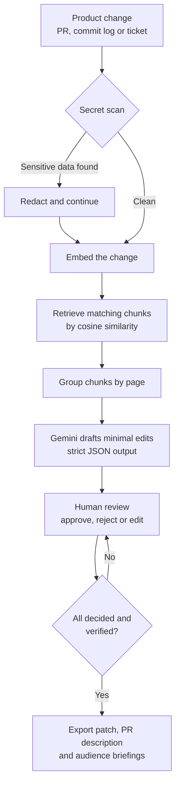
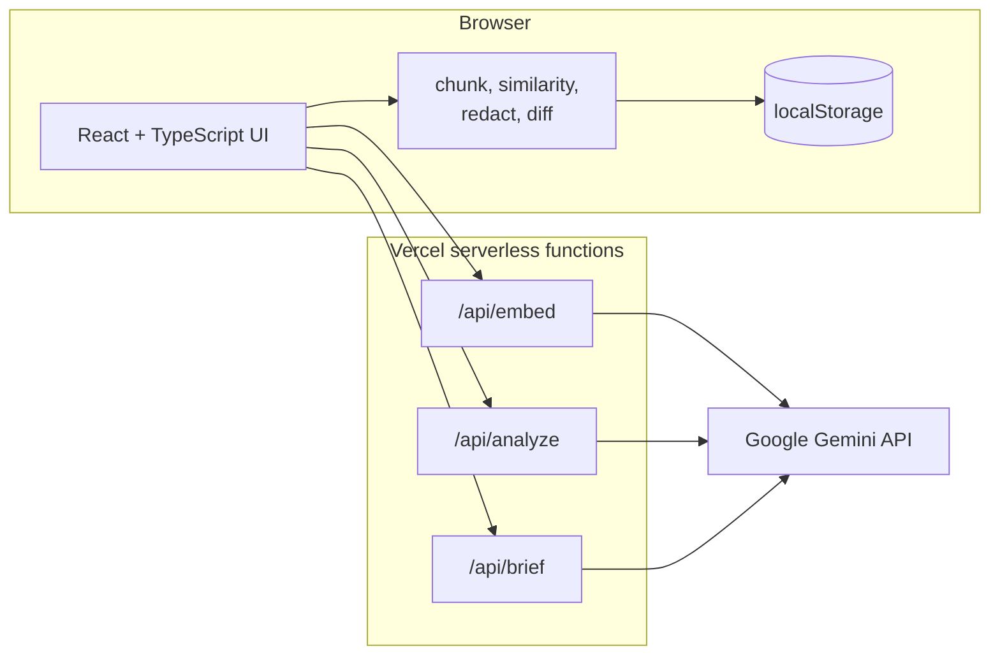
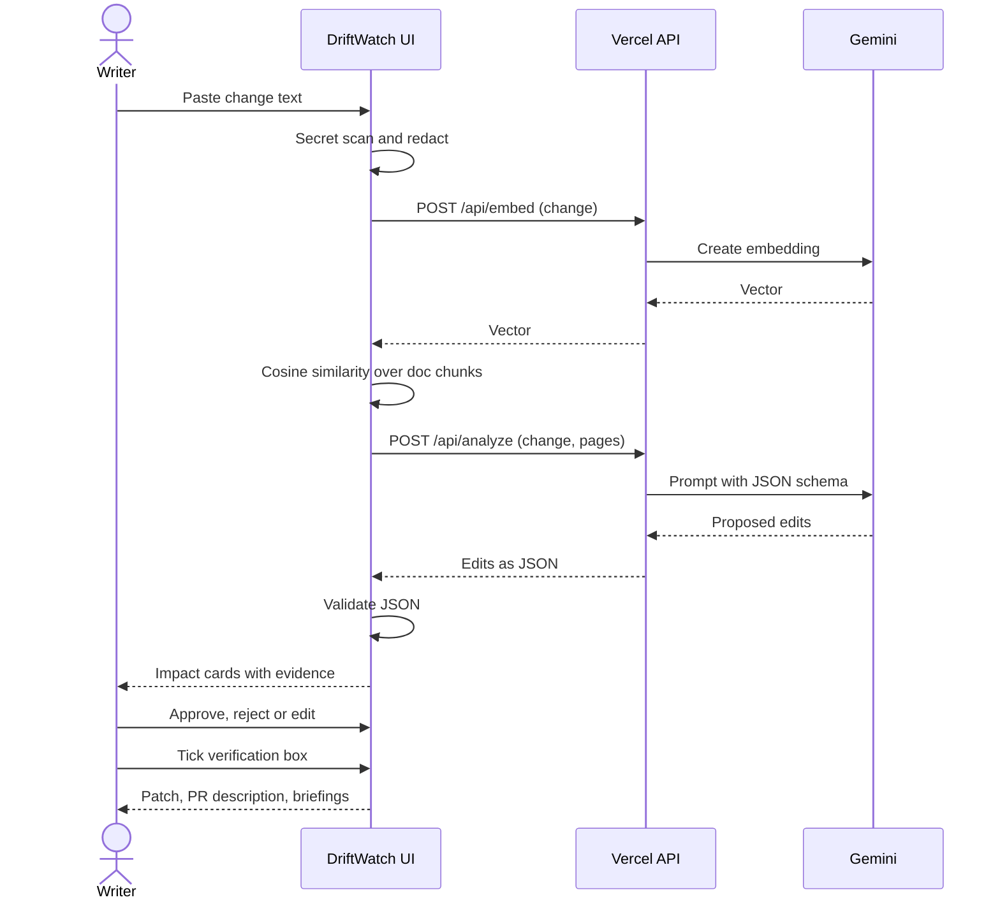
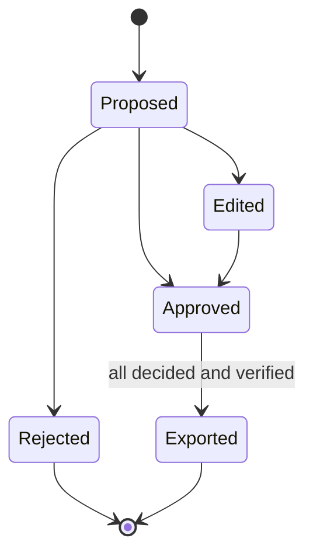

<div align="center">

# 🛰️ DriftWatch

### "AI proposes. A human decides."

[](https://driftwatch-gen-ai.vercel.app/)


</div>

---

## 📌 Overview

When a product changes (a pull request, commit log, or ticket), **DriftWatch** finds which documentation pages have gone stale and proposes surgical fixes. A human verifies and approves each fix before exporting a Git patch.

> 🔗 **Live app:** https://driftwatch-gen-ai.vercel.app/

---

## ❗ The Problem

Product changes faster than documentation. A renamed flag or a new default can quietly make several help pages wrong, and nobody notices until a customer does.

| Without DriftWatch | With DriftWatch |
|---|---|
| Writers learn about changes late or by accident | Paste the change; affected pages are found in seconds |
| Manual search across many pages | Semantic retrieval ranks the pages most likely to be stale |
| AI output trusted blindly | Every edit needs human approval and a verification checkbox |
| Confidential text pasted into AI tools | A secret scanner blocks sensitive data before anything is sent |

---

## ✨ Key Features

1. 🔎 **RAG-Driven Drift Detection:** Markdown pages are chunked by heading and embedded using Gemini vector embeddings. When a product change is submitted, cosine similarity retrieves the affected candidate pages.
2. ✅ **Human Accuracy Gate:** Nothing exports until a human approves the proposed edit. Includes side-by-side visual diffs, inline Markdown editing, and verification checkboxes.
3. 🔒 **Secret Scanner:** Automatically intercepts API keys, passwords, bearer tokens, emails, and IP addresses before text is sent to the AI.
4. 📣 **Multi-Audience Briefings:** Generates plain-language communications tailored for Administrators, Executives, and Support teams.
5. ⏱️ **Automation Efficiency Logger:** Tracks engineering hours saved per release cycle.
6. 🐍 **Git Pipeline Automation:** Includes `scripts/drift_check.py` and a GitHub Actions workflow (`.github/workflows/drift.yml`) that audit documentation staleness on pull requests.

---

## 🔄 Workflow



---

## 🏗️ Architecture



The API key lives only in server-side environment variables. The browser never sees it.

---

## 🔁 Request Sequence



---

## 🧭 Review States



---

## 🧰 Tech Stack and Skills

| Area | Tools and concepts |
|---|---|
| **Frontend** | React, TypeScript, Vite, React Router, plain CSS, responsive and accessible UI |
| **Generative AI** | Google Gemini API, prompt design, structured (JSON) output, confidence scoring, hallucination control |
| **Retrieval (RAG)** | Vector embeddings, heading-based chunking, cosine similarity, candidate page retrieval |
| **Backend** | Vercel serverless functions, secure API key handling, error handling and retry on rate limits |
| **Automation** | Python (PyYAML), `git diff` parsing, GitHub Actions on pull requests |
| **Docs-as-code** | Markdown, YAML front matter, topic-based content (Concept / Task / Reference), metadata checks |
| **Security** | Pre-send secret and PII scanning, no API keys in client code |
| **Technical writing** | Surgical doc edits, release-note drafting, audience-specific briefings |
| **Deployment** | Git, GitHub, Vercel |

---

## 🧪 Prompt Design Principles

1. Edit **only** what the change affects.
2. **Never invent** product behavior that is not in the change text.
3. Return `low` confidence when evidence is weak.
4. Respond in a strict JSON schema, and validate it on the client.

---

## ⚙️ Environment Variables

Copy `.env.example` to `.env`:

```bash
# Gemini API Key
GEMINI_API_KEY="your-gemini-api-key"

# Gemini Generation & Reasoning Model
GEMINI_MODEL="gemini-3.8-flash"

# Gemini Embedding Model
GEMINI_EMBED_MODEL="gemini-embedding-2-preview"
```

> ⚠️ Never commit `.env`. Confirm it is listed in `.gitignore`.

---

## 💻 Local Development & Setup

### Install dependencies
```bash
npm install
```

### Run the full-stack dev server
```bash
npm run dev
```

### Deploy to Vercel
```bash
npm i -g vercel
vercel login
vercel --prod
```
Then add the three environment variables under **Vercel → Settings → Environment Variables** and redeploy.

---

## 📖 How to Use

1. **Load sample project** on the Radar page.
2. Open **Report Change** and paste a change (or load the example change).
3. Click **Analyze impact**. Redact anything the scanner flags.
4. Open **Review**. Check the evidence, then approve, reject, or edit each proposal.
5. Tick the verification box, then open **Export** to download the patch.
6. Apply it with `git apply <file>.patch` and commit.

---

## 🐍 Python Drift Check

```bash
pip install -r scripts/requirements.txt
git diff --name-only origin/main | python scripts/drift_check.py
```

The script lists documentation pages whose `source_files` front matter matches the changed files, and exits with code `1` if any of them was last verified before the change. The workflow in `.github/workflows/drift.yml` runs it on every pull request.

---

## 📁 Project Structure

```
├── api/                    # Vercel serverless functions (embed, analyze, brief)
├── docs/images/            # README screenshots
├── public/docs/            # Sample Markdown docs with YAML front matter
├── data/                   # Sample change text
├── scripts/                # Python drift-check script
├── .github/workflows/      # PR automation
└── src/
    ├── components/         # UI components
    ├── pages/              # Radar, ReportChange, Review, ContentMap, Export, Guide
    └── lib/                # chunk, similarity, store, redact, diff, api
```

---

## ⚠️ Limitations

- AI suggestions can be wrong, so **always verify edits against the real product**.
- Data is stored in the browser (`localStorage`), so it is not shared across devices.
- Retrieval quality depends on how well the docs are structured and tagged.

## 🗺️ Roadmap

- [ ] Persistent database (for example Supabase with pgvector)
- [ ] Retrieval evaluation set with hit-rate scoring
- [ ] Direct pull request creation through the GitHub API
- [ ] Support for DITA and static site generators
Framework followed
---

<div align="center">

⭐ If you found this useful, consider starring the repo.

</div>
